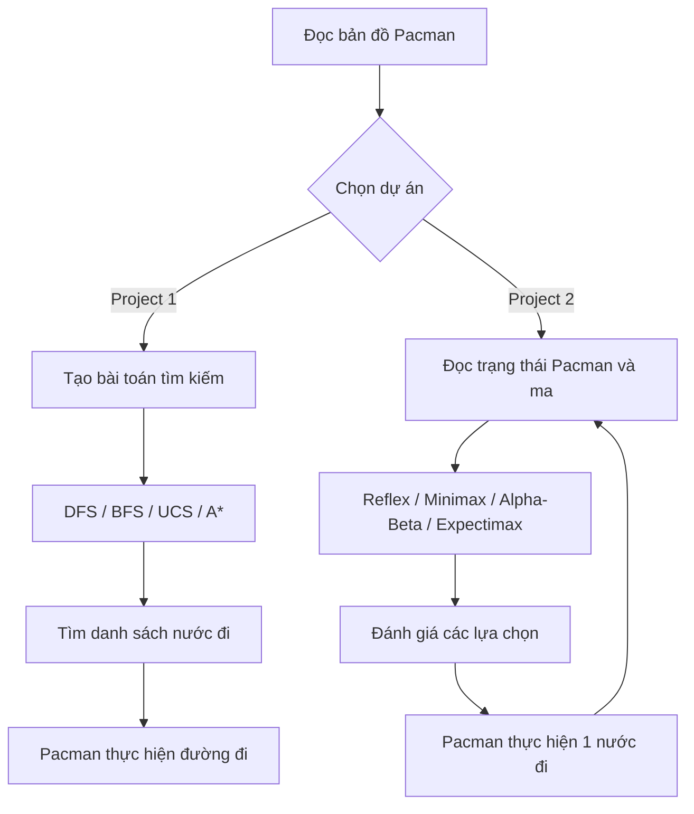

# PACMAN AI — Tìm đường & Đối kháng nhiều tác nhân

**UC Berkeley CS188 — Fall 2025**

Một dự án học tập sử dụng trò chơi **Pacman** để minh họa cách trí tuệ nhân tạo (AI) tìm đường, ra quyết định và ứng phó với các đối thủ.

**Báo cáo chi tiết:** - [(Report)](https://www.overleaf.com/project/6afab30ea6b4fbf99f5c5d55/share#29477d6e41dad48ef4c4815d3b540b876bb2bf3f23a1a0cf)

Dự án gồm **hai bài độc lập**, dựa trên đề bài chính thức của UC Berkeley:

| Phần | Nội dung | Thuật toán | Các file trọng tâm |
| --- | --- | --- | --- |
| **Project 1 — Search** |Cách Pacman tìm đường qua mê cung | DFS, BFS, UCS, A*, tìm bốn góc, tìm và ăn toàn bộ thức ăn | `search.py`, `searchAgents.py` |
| **Project 2 — Multi-Agent Search** | Pacman đưa quyết định khi có ma truy đuổi | Reflex Agent, Minimax, Alpha-Beta, Expectimax, hàm đánh giá | `multiAgents.py` |

Nếu chỉ muốn xem AI hoạt động, hãy đi thẳng đến [Hướng dẫn chạy lần đầu](#4-chạy-lần-đầu). Nếu muốn hiểu từng thuật toán, xem [Project 1](#6-project-1--search-tìm-đường) và [Project 2](#7-project-2--multi-agent-search-đối-kháng).


## 1. Một số thuật ngữ?

- **Pacman**: nhân vật màu vàng đi trong mê cung, ăn chấm thức ăn và tránh ma.
- **Agent (tác nhân AI)**: chương trình tự điều khiển Pacman đi lên, xuống, trái hay phải
- **Layout (bản đồ)**: kiểu mê cung, ví dụ `tinyMaze`, `mediumMaze`, `smallClassic`.
- **Thuật toán tìm kiếm**: cách AI tìm một chuỗi bước đi đến mục tiêu.
- **Heuristic (hàm ước lượng)**: cách AI ước lượng mục tiêu còn xa bao nhiêu để tìm kiếm nhanh hơn.
- **Terminal (cửa sổ lệnh)**: nơi bạn gõ một dòng lệnh để khởi chạy chương trình.
- **Autograder**: bộ kiểm tra tự động của Berkeley; giúp phát hiện các câu chưa triển khai hoặc triển khai sai.


## 2.  Chuẩn bị

### 2.1. Phần mềm

| Độ ưu tiên | Phần mềm | Tác vụ | Link download |
| --- | --- | --- | --- |
| **Bắt buộc** | **Python 3** | Chạy Pacman và thuật toán | <https://www.python.org/downloads/> |
| **Tùy chọn** | **Git** | Tải/đồng bộ dự án bằng `git clone` | <https://git-scm.com/downloads> |
| **Tùy chọn, khuyên dùng** | **Visual Studio Code** | Mở thư mục và gõ lệnh dễ hơn | <https://code.visualstudio.com/> |

Trong tài liệu CS188 Fall 2025, Berkeley yêu cầu **Python 3.6 trở lên** và khuyến nghị Python 3.9. Tuy nhiên, **Python 3.9** đã hết hỗ trợ bảo mật từ ngày 31/10/2025. Nếu cài máy mới vào năm 2026, nên chọn **Python 3.11 hoặc 3.12** (còn được hỗ trợ) và chạy autograder để xác nhận tương thích với bộ mã của bạn.

### 2.2. Kiểm tra Python

Mở **PowerShell / Command Prompt** trên Windows hoặc **Terminal** trên macOS/Linux, gõ:

```bash
python --version
```

Nếu xuất hiện ví dụ `Python 3.11.x` là đã nhận diện được Python. Nếu báo không tìm thấy lệnh, thử:

```bash
# Windows
py -3 --version
```

```bash
# macOS / Linux
python3 --version
```

Trong các ví dụ bên dưới, `python` là tên lệnh mặc định. Nếu máy bạn chỉ dùng được `py -3` hoặc `python3`, **thay `python` trong mọi lệnh bằng tên tương ứng**.

Kiểm tra thư viện giao diện (tùy chọn):

```bash
python -m tkinter
```

Nếu hiện một cửa sổ thử Tkinter thì có thể đóng cửa sổ này rồi tiếp tục. Nếu báo `No module named tkinter`, xem phần [Xử lý lỗi](#10-các-lỗi-thường-gặp-và-cách-xử-lý).

## 3. Tải dự án về máy


### Cách A — Tải ZIP

1. Mở trang repository GitHub của dự án (đường dẫn được người chia sẻ dự án cung cấp).
2. Nhấn nút màu xanh hoặc nút **Code** → **Download ZIP**.
3. Vào thư mục **Downloads/Tải xuống**, nhấp chuột phải vào file ZIP → **Extract All... / Giải nén**.
4. Mở thư mục đã giải nén. Bạn cần nhìn thấy `README.md` và các thư mục `project1-search/`, `project2-multiagent/` nếu repository dùng cấu trúc đề xuất bên dưới.
5. Nếu máy chưa có VS Code, vẫn có thể chạy bằng Terminal tại đúng thư mục game.

> Với repository riêng tư, bạn phải được chủ repository cấp quyền trước mới có thể tải về.

### Cách B — Clone bằng Git

1. Cài Git ở mục 2.
2. Trên GitHub, mở repository → **Code** → **HTTPS** → nhấn biểu tượng **Copy** để sao chép đúng đường dẫn của repository.
3. Mở Terminal tại vị trí muốn lưu dự án.
4. Gõ `git clone`, thêm một dấu cách, **dán đường dẫn vừa sao chép** và nhấn Enter.

Ví dụ minh họa (phải thay địa chỉ theo repository thật của nhóm):

```bash
git clone https://github.com/TEN-TAI-KHOAN/TEN-REPOSITORY.git
cd TEN-REPOSITORY
```


### Cấu trúc thư mục

```text
pacman-ai-pj1-pj2/
│
├── README.md
│
├── project1-search/                  # Bộ Project 1 (Search)
│   ├── pacman.py                     # Chương trình Pacman
│   ├── search.py                     # DFS, BFS, UCS, A*
│   ├── searchAgents.py               # Các tác nhân/tình huống tìm kiếm
│   ├── game.py, util.py, layout.py   # File hỗ trợ (minh họa tên)
│   ├── autograder.py                 # Bộ kiểm thử Project 1
│   ├── layouts/                      # Các bản đồ
│   ├── test_cases/                   # Bài kiểm thử
│   └── ...                           # Các file Berkeley khác
│
└── project2-multiagent/              # Bộ Project 2 (Multi-Agent)
    ├── pacman.py
    ├── multiAgents.py                # Reflex, Minimax, Alpha-Beta, Expectimax...
    ├── game.py, util.py, layout.py   # File hỗ trợ của riêng Project 2
    ├── ghostAgents.py                # Chính sách di chuyển của ma
    ├── autograder.py                 # Bộ kiểm thử Project 2
    ├── layouts/
    ├── test_cases/
    └── ...
```

Terminal phải ở **thư mục chứa `pacman.py` của project đó**.

### Nếu clone xong không thấy `pacman.py` hoặc thiếu bộ mã nguồn

Chỉ có ba file `search.py`, `searchAgents.py`, `multiAgents.py` **không đủ** để chạy Pacman. Cần những file hỗ trợ, bản đồ và autograder đi kèm từng bộ Berkeley. Bạn có thể lấy bộ khung chính thức tại:

- **Project 1:** [search.zip của CS188 Fall 2025](https://inst.eecs.berkeley.edu/~cs188/fa25/assets/projects/search.zip).
- **Project 2:** [multiagent.zip của CS188 Fall 2025](https://inst.eecs.berkeley.edu/~cs188/fa25/assets/projects/multiagent.zip).

Giải nén **vào hai thư mục riêng**, giữ nguyên các file hỗ trợ, sau đó bổ sung các file thuật toán đã được triển khai hợp lệ. Bộ ZIP chính thức là **mã khung bài tập**, không phải bộ lời giải hoàn thiện.


## 4. Chạy lần đầu

### 4.1. Mở đúng thư mục và Terminal

* **Với VS Code:** mở VS Code → **File → Open Folder...** → chọn `project1-search` hoặc `project2-multiagent` → **Terminal → New Terminal**.

**Không dùng VS Code trên Windows:** mở thư mục `project1-search` trong File Explorer, nhấp vào **thanh địa chỉ** phía trên, gõ `cmd`, nhấn Enter. Một cửa sổ dòng lệnh sẽ mở đúng tại thư mục đó. Làm tương tự với `project2-multiagent`.

Bạn có thể kiểm tra bằng lệnh:

```bash
# Windows
 dir
```

```bash
# macOS / Linux
ls
```

Bạn cần thấy file `pacman.py` trong danh sách. Nếu không thấy, hãy mở đúng thư mục con trước khi chạy.

### 4.2. Chạy Project 1 — Demo tìm đường có sẵn

Mở Terminal tại thư mục `project1-search`, gõ:

```bash
python pacman.py -l tinyMaze -p SearchAgent -a fn=tinyMazeSearch
```

Đây là **bài demo với đường đi đã được định sẵn trong bộ khung Berkeley**; nó không chứng minh DFS/BFS/A* đã được lập trình. Nếu bộ mã hỗ trợ đầy đủ, một cửa sổ Pacman sẽ mở và nhân vật tự đi qua `tinyMaze`.

### 4.3. Chạy Project 2 — Xem Pacman tự điều khiển

Đóng ván trước. Mở Terminal **mới** tại `project2-multiagent`, rồi gõ:

```bash
python pacman.py -p ReflexAgent -l testClassic
```

Pacman sẽ tự đi; bạn **không cần bấm phím mũi tên**. Bạn có thể chạy thêm bản thuật toán Alpha-Beta:

```bash
python pacman.py -p AlphaBetaAgent -l smallClassic -a depth=2
```

**Nếu muốn tự chơi bằng bàn phím** thay vì dùng AI, tại một trong hai thư mục chứa `pacman.py` chạy:

```bash
python pacman.py
```

Sử dụng các phím mũi tên để điều khiển Pacman.

### 4.4. Xem nhanh lệnh `pacman.py` có những lựa chọn gì

```bash
python pacman.py -h
```

Các tham số thường dùng:

| Tham số | Ý nghĩa  | Ví dụ |
| --- | --- | --- |
| `-p` | Chọn AI điều khiển Pacman | `-p ExpectimaxAgent` |
| `-l` | Chọn bản đồ | `-l smallClassic` |
| `-a` | Truyền thông số cho Agent | `-a depth=3,evalFn=better` |
| `-g` | Chọn loại ma | `-g DirectionalGhost` |
| `-k` | Chọn số lượng ma | `-k 2` |
| `-n` | Chạy nhiều ván liên tiếp | `-n 10` |
| `-q` | Chạy yên lặng, không hiện giao diện Pacman | `-q` |
| `-f` | Dùng hạt giống ngẫu nhiên cố định | `-f` |
| `-z` | Thay đổi kích thước hiển thị | `-z 0.5` |
| `--frameTime 0` | Giảm thời gian chờ giữa khung hình | `--frameTime 0` |

**Lưu ý:** Tham số `-a` có thể chứa nhiều cặp `tên=giá trị`, ngăn cách bằng dấu phẩy **không cần dấu cách**. Ví dụ `-a evalFn=better,depth=3`.

---

## 5. Cách hiểu Pacman AI hoạt động



Project 1 thường lập kế hoạch đường đi rồi lần lượt thực hiện kế hoạch đó. Project 2 thường tính toán lại quyết định ở mỗi lượt dựa trên tình hình mới (vị trí Pacman, vị trí ma, thức ăn...). Hai project phù hợp để minh họa hai cách thiết kế AI khác nhau.

## 6. Project 1 — Search (Tìm đường)

**Đề bài gốc:** <https://inst.eecs.berkeley.edu/~cs188/archive/fa25/projects/proj1/>

### 6.1. Mục tiêu và 8 câu hỏi

Project 1 yêu cầu Pacman tìm đường đến một vị trí cố định, đi qua bốn góc mê cung, sau đó thu thập toàn bộ thức ăn. Tổng điểm nội dung bài tập: **25 điểm**.

| Câu | Điểm | Nội dung của Berkeley | Hàm/lớp trọng tâm |
| --- | ---: | --- | --- |
| **Q1** | 3 | **Depth-First Search (DFS):** thử đi sâu vào một nhánh trước khi quay lại | `depthFirstSearch()` — `search.py` |
| **Q2** | 3 | **Breadth-First Search (BFS):** mở rộng lần lượt từng lớp để tìm đường ít bước nhất khi các bước có cùng chi phí | `breadthFirstSearch()` — `search.py` |
| **Q3** | 3 | **Uniform-Cost Search (UCS):** ưu tiên đường có tổng chi phí đã đi thấp nhất | `uniformCostSearch()` — `search.py` |
| **Q4** | 3 | **A\* Search:** kết hợp chi phí đã đi và chi phí còn lại được ước lượng | `aStarSearch()` — `search.py` |
| **Q5** | 3 | **Corners Problem:** tạo mô hình để Pacman ghé đủ bốn góc | `CornersProblem` — `searchAgents.py` |
| **Q6** | 3 | **Corners Heuristic:** ước lượng quãng đường qua các góc còn lại | `cornersHeuristic()` — `searchAgents.py` |
| **Q7** | 4 | **Food Heuristic:** tìm đường thu thập toàn bộ chấm thức ăn với A\* | `foodHeuristic()` — `searchAgents.py` |
| **Q8** | 3 | **Closest Dot:** liên tục tìm chấm thức ăn gần nhất (nhanh, không bảo đảm lộ trình tổng ngắn nhất) | `findPathToClosestDot()` và `AnyFoodSearchProblem.isGoalState()` — `searchAgents.py` |

**Điểm thưởng Q7:** Tổng điểm chuẩn của Project 1 là **25**. Riêng Q7 có **1 điểm thưởng tùy chọn**: trên bản đồ `trickySearch`, heuristic không âm, không tầm thường, nhất quán và mở rộng **không quá 7.000 nodes** có thể đạt **5/4 điểm**. Như vậy, điểm lý thuyết tối đa là **26/25** nếu tính thưởng (cần vượt qua các kiểm tra hợp lệ khác của autograder).


### 6.2. Giải thích file `search.py`

`search.py` là nơi định nghĩa các **thuật toán tìm kiếm tổng quát**, không phụ thuộc riêng vào đồ họa Pacman.

| Thành phần | Vai trò trong code |
| --- | --- |
| `SearchProblem` | Bộ khung mô tả bài toán: trạng thái ban đầu, đích đến, trạng thái kế tiếp và chi phí đường đi. |
| `getStartState()` | Trả về điểm/trạng thái bắt đầu. |
| `isGoalState(state)` | Trả lời trạng thái hiện tại đã là mục tiêu chưa. |
| `getSuccessors(state)` | Cung cấp các bước tiếp theo dưới dạng `(trạng thái kế, hành động, chi phí bước)`. |
| `getCostOfActions(actions)` | Tính tổng chi phí của chuỗi hành động. |
| `tinyMazeSearch()` | Đường đi mẫu được viết sẵn cho riêng bản đồ `tinyMaze`. |
| `depthFirstSearch()` / `dfs` | DFS: thường sử dụng `Stack` (vào sau, ra trước). |
| `breadthFirstSearch()` / `bfs` | BFS: thường sử dụng `Queue` (vào trước, ra trước). |
| `uniformCostSearch()` / `ucs` | UCS: sử dụng hàng đợi ưu tiên theo tổng chi phí `g(n)`. |
| `aStarSearch()` / `astar` | A\*: sử dụng ưu tiên `f(n) = g(n) + h(n)`. |
| `nullHeuristic()` | Hàm ước lượng luôn bằng 0; khi dùng với A\* sẽ cho cách ưu tiên tương tự UCS. |

Các hàm tìm kiếm trả về **danh sách hành động hợp lệ** như `North`, `South`, `East`, `West`. Đề Berkeley yêu cầu sử dụng `Stack`, `Queue`, `PriorityQueue` từ `util.py` khi thích hợp để tương thích autograder.

### 6.3. Giải thích file `searchAgents.py`

`searchAgents.py` là lớp **kết nối thuật toán tìm kiếm với trò chơi Pacman**: xác định Pacman phải tìm gì, lựa chọn thuật toán nào và chuyển kết quả thành từng bước di chuyển.

| Thành phần | Vai trò trong code |
| --- | --- |
| `GoWestAgent` | Agent ví dụ: cứ đi sang trái nếu còn đi được. |
| `SearchAgent` | Agent tổng quát: gọi thuật toán từ `search.py`, lưu đường đi rồi thực hiện từng bước. |
| `registerInitialState()` | Trong `SearchAgent`, tính toán kế hoạch ngay khi trò chơi bắt đầu. |
| `getAction()` | Trả về bước đi tiếp theo từ kế hoạch đã lưu. |
| `PositionSearchProblem` | Tìm đường từ vị trí hiện tại đến một tọa độ đích. |
| `StayEastSearchAgent`, `StayWestSearchAgent` | Ví dụ UCS với **hàm chi phí khác nhau**, dẫn đến cách chọn đường khác nhau. |
| `manhattanHeuristic()` | Ước lượng khoảng cách theo tổng chênh lệch tọa độ ngang và dọc. |
| `euclideanHeuristic()` | Ước lượng khoảng cách đường thẳng. |
| `CornersProblem` | Trạng thái gồm vị trí Pacman và thông tin bốn góc đã ghé. |
| `cornersHeuristic()` / `AStarCornersAgent` | Ước lượng quãng đường qua các góc; dùng với A\*. |
| `FoodSearchProblem` | Mô tả việc di chuyển và trạng thái các chấm thức ăn còn lại. |
| `foodHeuristic()` / `AStarFoodSearchAgent` | Ước lượng chi phí ăn hết thức ăn để tăng tốc A\*. |
| `ClosestDotSearchAgent` | Tìm chấm gần nhất, đi đến đó, rồi lập kế hoạch tiếp. |
| `AnyFoodSearchProblem` | Bài toán đặt mục tiêu là **bất kỳ ô nào còn thức ăn**. |
| `mazeDistance()` | Tính số bước theo đường đi thực tế trong mê cung, có tính tường. |

**Lưu ý kỹ thuật:** Một heuristic tốt cần không âm, bằng 0 ở trạng thái đích và nhất quán (*consistent*) khi bài toán/autograder yêu cầu. Một heuristic ước lượng quá mức có thể khiến A\* mất bảo đảm tối ưu.

### 6.4. Lệnh chạy Project 1 theo từng nhóm bài

Chạy **trong thư mục `project1-search`**. Các lệnh dưới đây yêu cầu các phần tương ứng **đã được triển khai**, ngoại trừ lệnh `tinyMazeSearch` được cung cấp sẵn.

**Demo được cấp sẵn (chạy được ngay khi bộ hỗ trợ đầy đủ):**

```bash
python pacman.py -l tinyMaze -p SearchAgent -a fn=tinyMazeSearch
```

**Q1 — DFS:**

```bash
python pacman.py -l mediumMaze -p SearchAgent -a fn=dfs
```

**Q2 — BFS:**

```bash
python pacman.py -l mediumMaze -p SearchAgent -a fn=bfs
```

**Q3 — UCS:**

```bash
python pacman.py -l mediumMaze -p SearchAgent -a fn=ucs
python pacman.py -l mediumDottedMaze -p StayEastSearchAgent
python pacman.py -l mediumScaryMaze -p StayWestSearchAgent
```

**Q4 — A\* với khoảng cách Manhattan:**

```bash
python pacman.py -l bigMaze -z 0.5 -p SearchAgent -a fn=astar,heuristic=manhattanHeuristic
```

**Q5 — Đi qua bốn góc:**

```bash
python pacman.py -l tinyCorners -p SearchAgent -a fn=bfs,prob=CornersProblem
```

**Q6 — A\* cho bốn góc:**

```bash
python pacman.py -l mediumCorners -p AStarCornersAgent -z 0.5
```

**Q7 — A\* để ăn hết thức ăn:**

```bash
python pacman.py -l trickySearch -p AStarFoodSearchAgent
```

**Q8 — Liên tục ăn chấm gần nhất:**

```bash
python pacman.py -l bigSearch -p ClosestDotSearchAgent -z 0.5
```

Một số bản đồ lớn có thể khiến Pacman mất thời gian **tính đường đi trước khi di chuyển**.

---

## 7. Project 2 — Multi-Agent Search (Đối kháng)

**Đề bài gốc:** <https://inst.eecs.berkeley.edu/~cs188/archive/fa25/projects/proj2/>

### 7.1. Mục tiêu và 5 câu hỏi

Project 2 đưa ma vào trò chơi. Pacman không chỉ tìm đường mà còn phải cân nhắc **đối thủ có thể đi đâu sau mình**. Tổng điểm nội dung bài tập: **25 điểm**.

| Câu | Điểm | Nội dung của Berkeley | Hàm/lớp trọng tâm |
| --- | ---: | --- | --- |
| **Q1** | 4 | **Reflex Agent:** chấm điểm từng hành động trước mắt theo thức ăn và ma | `ReflexAgent.evaluationFunction()` |
| **Q2** | 5 | **Minimax:** Pacman chọn MAX, mỗi ma là một lớp MIN | `MinimaxAgent.getAction()` |
| **Q3** | 5 | **Alpha-Beta Pruning:** Minimax có loại bỏ nhánh không cần thiết | `AlphaBetaAgent.getAction()` |
| **Q4** | 5 | **Expectimax:** dự đoán hành động ma theo xác suất **đồng đều** | `ExpectimaxAgent.getAction()` |
| **Q5** | 6 | **Evaluation Function:** đánh giá trạng thái tốt hơn để AI quyết định hiệu quả | `betterEvaluationFunction()` |


### 7.2. So sánh các cách Pacman ra quyết định

| Cách làm | Pacman đang giả định điều gì? | Ưu/nhược điểm dễ hiểu |
| --- | --- | --- |
| **Reflex** | Chỉ cần xem hệ quả của nước đi ngay trước mắt | Nhanh, nhưng ít nhìn xa. |
| **Minimax** | Ma luôn chọn hành động bất lợi nhất cho Pacman | Thận trọng, nhưng có thể bỏ lỡ cơ hội. |
| **Alpha-Beta** | Tương tự Minimax, nhưng không xét các nhánh chắc chắn không ảnh hưởng kết quả | Thường giảm số phép tính; **không mặc định chơi hay hơn Minimax** ở cùng độ sâu. |
| **Expectimax** | Ma chọn đều trong các nước đi hợp lệ | Có thể tận dụng rủi ro/cơ hội; không khớp mọi loại ma. |


### 7.3. Giải thích file `multiAgents.py`

Phần mô tả này dựa trên **bản `multiAgents.py` đã đối chiếu**.

| Thành phần | Vai trò trong code |
| --- | --- |
| `ReflexAgent` | Q1. Chọn hành động dựa vào điểm đánh giá tức thời; có xét khoảng cách đến thức ăn, ma và viên sức mạnh. |
| `scoreEvaluationFunction()` | Hàm chấm điểm mặc định của trạng thái game. |
| `MultiAgentSearchAgent` | Lớp cơ sở quản lý hàm đánh giá (`evalFn`) và độ sâu (`depth`). |
| `MinimaxAgent` | Q2. Duyệt cây nước đi Pacman → ma 1 → ma 2... để chọn phương án tốt nhất trong trường hợp bất lợi nhất. |
| `AlphaBetaAgent` | Q3. Duyệt Minimax có cắt tỉa bằng hai giới hạn `alpha` và `beta`. |
| `ExpectimaxAgent` | Q4. Thay tầng MIN của ma bằng giá trị kỳ vọng theo xác suất đều. |
| `betterEvaluationFunction()` | Q5. Chấm điểm trạng thái qua thức ăn còn lại, khoảng cách đường đi, viên sức mạnh, ma nguy hiểm và ma đang sợ. |
| `better` | Tên viết tắt cho `betterEvaluationFunction`, dùng trong lệnh `evalFn=better`. |
| `_nearestFoodPathDistance()` | Hàm BFS hỗ trợ tìm khoảng cách đường đi ngắn nhất đến thức ăn trong mê cung. |
| `_distancesFrom()` / `_MAZE_DISTANCE_CACHE` | Tính và ghi nhớ các khoảng cách đường đi để tránh lặp lại BFS quá nhiều lần. |


### 7.4. Các lệnh chạy Project 2

Chạy **trong thư mục `project2-multiagent`**.

**Q1 — Reflex Agent:**

```bash
python pacman.py -p ReflexAgent -l testClassic
```

**Q2 — Minimax:**

```bash
python pacman.py -p MinimaxAgent -l minimaxClassic -a depth=2
```

**Q3 — Alpha-Beta:**

```bash
python pacman.py -p AlphaBetaAgent -l smallClassic -a depth=3
```

**Q4 — Expectimax:**

```bash
python pacman.py -p ExpectimaxAgent -l minimaxClassic -a depth=3
```

**Q5 — Dùng hàm đánh giá cải tiến cùng Expectimax:**

```bash
python pacman.py -p ExpectimaxAgent -l smallClassic -a evalFn=better,depth=2
```

## 8. Kiểm tra chương trình bằng Autograder

**Autograder** là cách kiểm tra thuật toán có đáp ứng yêu cầu từng câu của Berkeley hay không; kết quả thắng 10/10 ván không thay thế được kiểm thử này.

### 8.1. Kiểm tra Project 1

Mở Terminal trong `project1-search`:

```bash
# Chấm toàn bộ 8 câu của Project 1
python autograder.py

# Ví dụ: chỉ chấm Q2 (BFS)
python autograder.py -q q2

# Chấm không bật đồ họa
python autograder.py --no-graphics
```

Có thể thay `q2` bằng `q1` đến `q8`. 

### 8.2. Kiểm tra Project 2

Mở Terminal trong `project2-multiagent`:

```bash
# Chấm toàn bộ 5 câu của Project 2
python autograder.py --no-graphics

# Ví dụ: chỉ chấm Q5 (hàm đánh giá)
python autograder.py -q q5 --no-graphics
```

Có thể thay `q5` bằng `q1` đến `q5`.


**Không trộn autograder Project 1 với Project 2:** Hai bộ có bài kiểm thử và yêu cầu khác nhau; việc chép file từ thư mục này sang thư mục kia có thể làm kiểm thử sai.


## 9. Gợi ý thử nghiệm và đánh giá AI

Nếu muốn xem AI nào hiệu quả, hãy so sánh trong cùng điều kiện: **bản đồ, loại ma, số ma, hàm đánh giá, số ván và độ sâu**.

Ví dụ, chạy Alpha-Beta với 50 ván:

```bash
python pacman.py -p AlphaBetaAgent -g DirectionalGhost -k 2 -l smallClassic -a evalFn=better,depth=3 -n 50 -q
```

Sau đó chạy Expectimax, giữ nguyên các tham số khác:

```bash
python pacman.py -p ExpectimaxAgent -g DirectionalGhost -k 2 -l smallClassic -a evalFn=better,depth=3 -n 50 -q
```

Muốn lặp lại thí nghiệm với chuỗi ngẫu nhiên có thể tái hiện.
```bash
python pacman.py -p ExpectimaxAgent -g DirectionalGhost -k 2 -l smallClassic -a evalFn=better,depth=3 -n 50 -q -f
```

